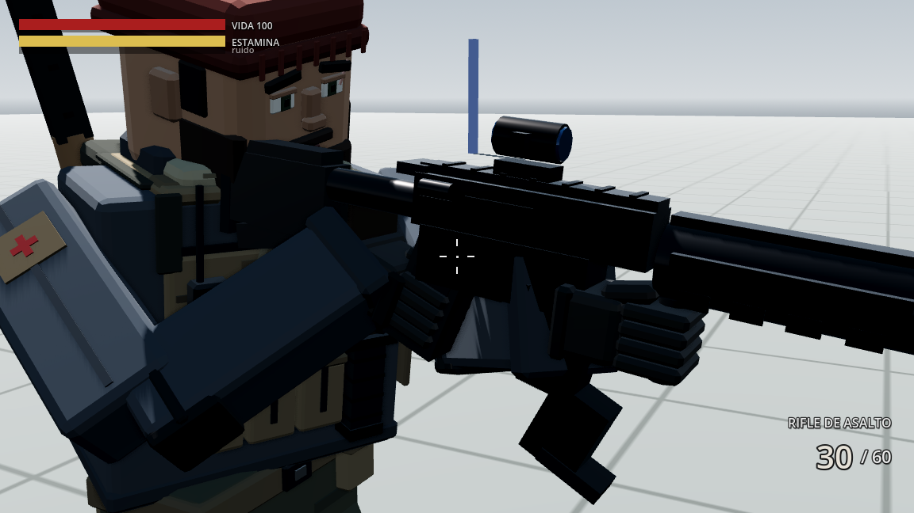
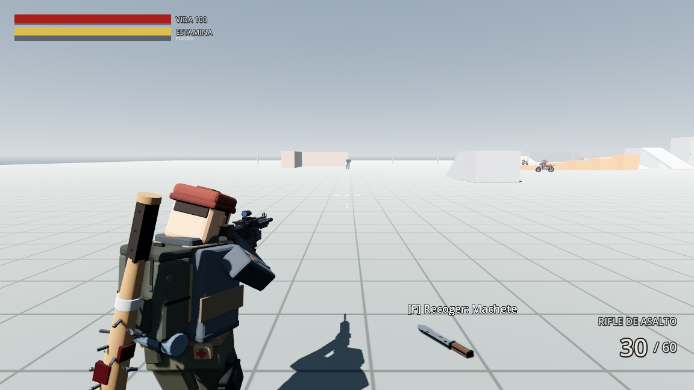

# Agarre e iluminación (2026-11-17)

## Manos

`Armas.grip()` se calibra con la posición y la inclinación de las empuñaduras de los modelos
actuales. La transformación de soldadura y el objetivo IK usan la misma referencia; cambiar
el agarre no cambia artificialmente la trayectoria de las balas.

La mano izquierda de armas largas ahora tiene objetivo completo de posición/orientación,
anclado al marcador `LeftGrip`/`SupportGrip`. Antes solo se colocaba una posición de brazo,
lo que podía dejar la palma girada o separada del guardamanos. Se conservan la recarga,
las tareas de la mano libre y el uso de una mano con armas cortas.

## Ambiente del nivel

En `scripts/nivel/nivel_pruebas.gd`:

- Cielo procedural con paleta fría y horizonte gris; luz solar ligeramente cálida.
- Sombras con tamaño angular de luz y mezcla entre cascadas.
- Tonemapping ACES, luz ambiente ajustada y contraste 1,03; saturación 0,78 conservada.
- Oclusión ambiental de contacto configurada (calidad Alta) y resplandor moderado.
- Niebla de distancia ligera, sin niebla volumétrica.

Las opciones de calidad existentes siguen controlando SSAO, glow, resolución y sombras.
El HUD conserva sus colores y el fondo nocturno del menú mantiene su tratamiento propio.
No se han añadido piezas redondas ni cambiado modelos/personajes o fuentes generadas.

## Comprobaciones

- `tests/agarre_armas.gd`: referencia de agarre derecha y apoyo izquierdo en armas largas.
- `tests/precision_mira.gd` y `precision_cerca.gd`: se mantienen las comprobaciones de
  alineación del cañón y disparos cercanos.
- Disparos y recarga de rifle ejecutados con `tests/escena_combate.tscn -- --arma=Rifle`.
- Capturas reales con Godot 4.6.3 / Compatibility (Mesa por software). No representan
  una medición de rendimiento GPU ni validan todos los efectos de Forward Plus.
