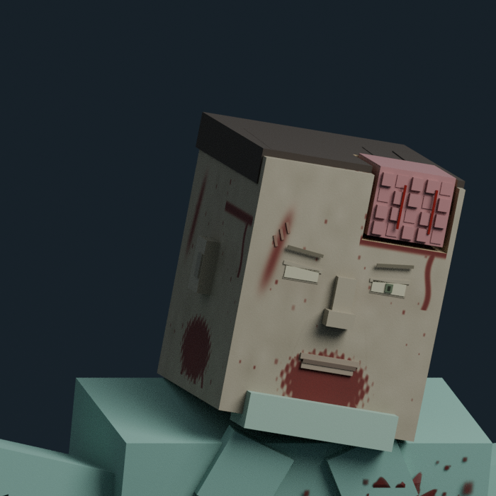
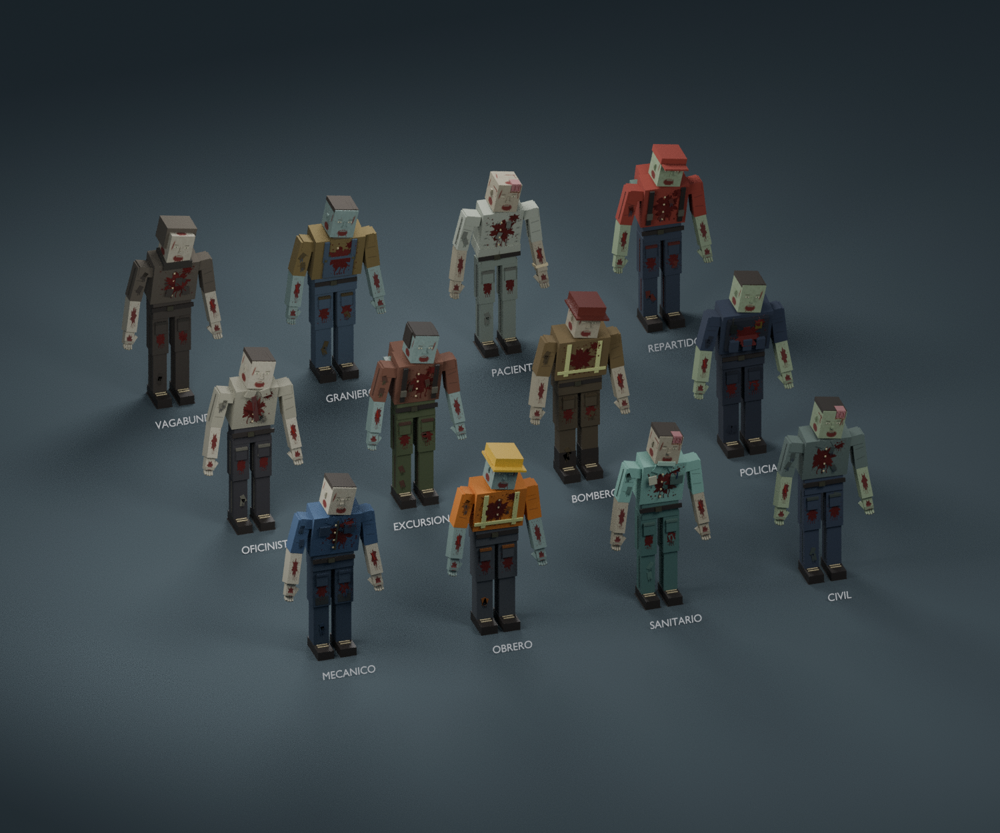
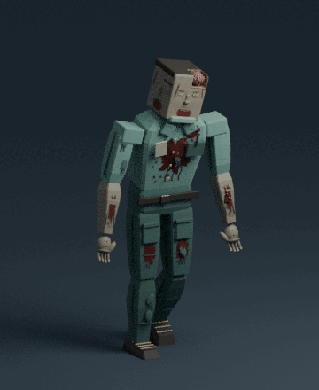
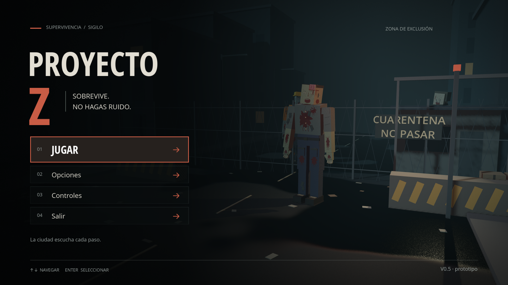

# Corrección v6: todas las piezas cuadradas

La petición vigente exige bloques en toda la geometría, tomando al protagonista como referencia.
La revisión v5 conservaba detalles ovalados: esta entrega los sustituye por cajas rectas.

- Ojos, iris, pupilas, palmas, dedos, pulgares y barba rectangulares.
- Torso, brazos, piernas y botas con sección rectangular constante.
- Cabeza plana sin relieve curvo; orejas, nariz y labios de cajas sin biseles.
- Cerebro de bloques con surcos ortogonales; coágulos y pliegues rectangulares.
- Botellas y antenas prismáticas; accesorios sin cilindros ni redondeos.
- Se mantienen texturas de piel, tejido y sangre. Las manchas pintadas son texturas,
  no geometría circular añadida. Cada variante conserva sus 15 piezas y seis clips.

El generador usa cajas estrictas locales al catálogo de zombis. Antes de unir piezas comprueba
que no haya caras suavizadas ni modificadores BEVEL/SUBSURF. El validador de GLB comprueba
además que los tres vértices de cada triángulo tengan la misma normal, verificando caras planas
en los bytes finales. No modifica al protagonista,
contratos de daño, ragdoll, IA, dimensiones de impacto ni tablas generadas del jugador.

Fuentes: `animaciones/blender/zombis/generar.py`, `refinado.py`, `rostro.py`, `deterioro.py`.
Regenerar con Blender y validar con `python3 animaciones/blender/zombis/validar.py`.
Motor disponible: Godot 4.6.3; pendiente comprobar en 4.7.2 y medir hordas en GPU.

## Validación final

- 12/12 GLB correctos: hashes, cuatro PNG embebidos, seis clips y normales planas por triángulo.
- 1.986–2.438 triángulos por variante; se mantiene techo de 16.000.
- Godot 4.6.3: 624/624 comprobaciones de modelos; 56/56 del menú con renderizado.
- Batería general: 102/102, `TODO BIEN`, incluidos arranque de menú y nivel.
- Revisados visualmente: catálogo de doce, primer plano y marcha; menú con captura real.
- El primer intento de menú agotó el tiempo de carga mientras se renderizaba el catálogo;
  repetición sin esa carga adicional: 56/56. No se modificaron tiempos ni aserciones.
