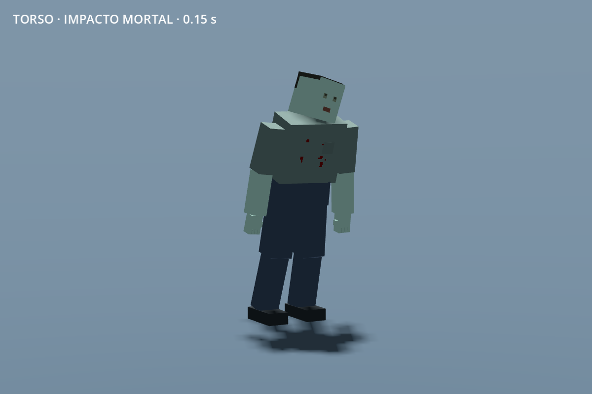
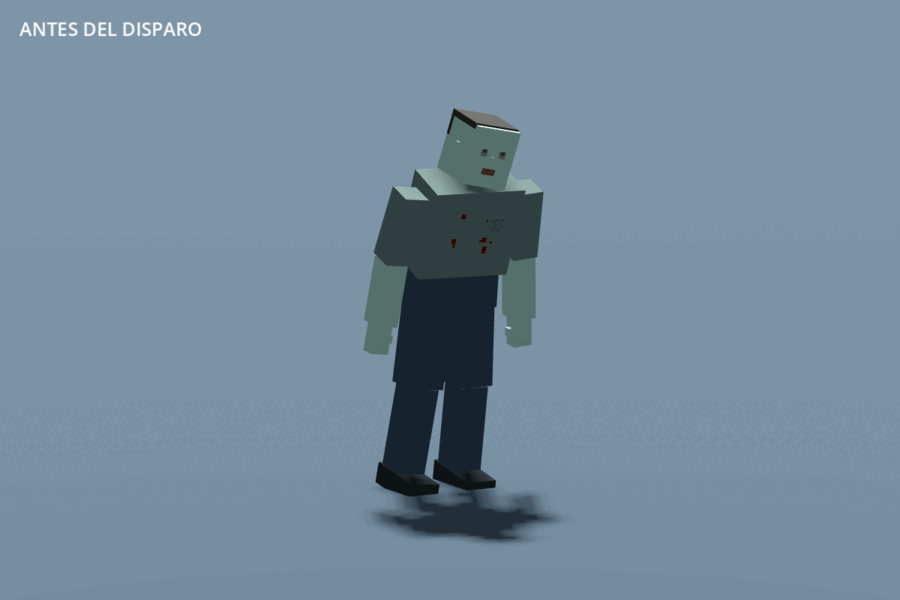
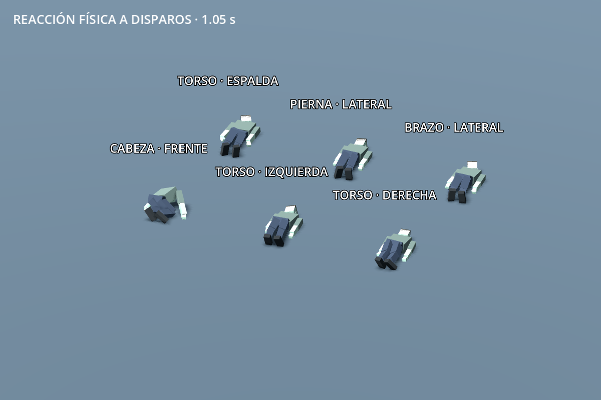
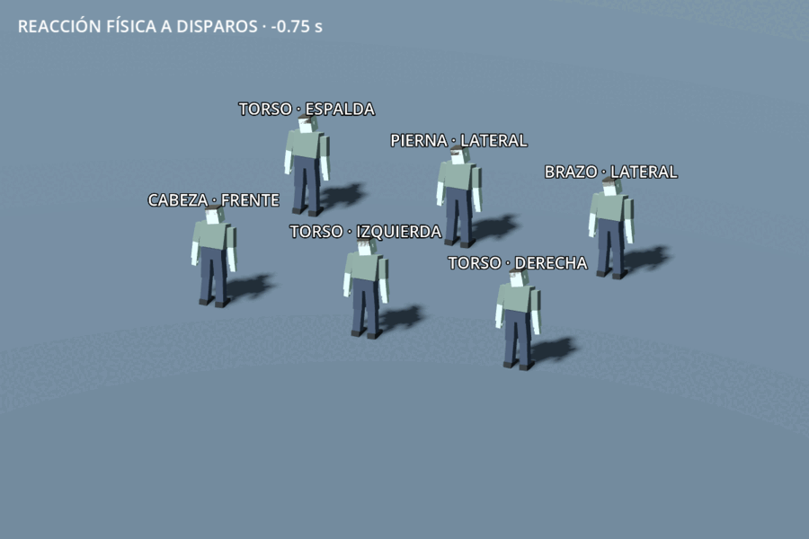
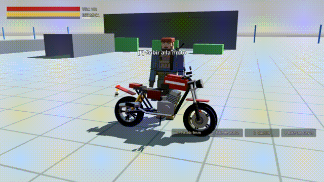

# Disparos localizados y manejo de moto

## Corrección vigente: se debe ver el golpe antes de la caída

La revisión anterior (`f6d9956`) seguía pareciendo un desplome: el reflejo muscular de la bala
se registraba, pero se descartaba al crear el ragdoll, y se perdía el apoyo casi inmediatamente.
Se corrige esa transición, se refuerza el reflejo local y se mantienen brevemente las piernas
antes de soltar tono. No se incrementa el impulso físico ni se añade una patada al cuerpo entero.
La cabeza y el torso reaccionan primero; después la gravedad y el entorno determinan la caída.

El estado de los muelles se copia para que la física y la animación viva no avancen el mismo
reloj dos veces. Se resta la rotación que la postura inicial ya contenía, evitando un salto
doble cuando el disparo mortal llega durante otro reflejo. No se añade una animación de muerte
prefijada ni se cambian modelos o manejo de moto.

Prueba de regresión física: un tiro frontal/posterior de pistola se compara con una muerte
sin impulso en la misma postura y suelo. Se exige >6° de reacción dirigida en cabeza y torso
mientras la pelvis no haya bajado 0,35 studs. La misma prueba se ejecutó sobre ambas versiones:

| Torso | f6d9956 | Corrección |
|---|---:|---:|
| Tiro posterior | 0,12° | 11,10° |
| Tiro frontal | 0,00° | 7,85° |

Son ángulos medidos respecto al control sin impulso, antes de la caída; no son una medida
biomecánica de una persona real. La cabeza alcanza 12,35–15,08° en la corrección. La versión
anterior falla cuatro aserciones nuevas del torso; la corregida pasa 97/97 de balística.
La batería general pasa 104/104. Motor: Godot 4.6.3; pendiente comprobar 4.7.2.





Primer plano reproducible: añadir `--detalle` a `tests/revision_balistica.gd`. Se muestra
primero un disparo no mortal y después uno mortal, con captura real de Godot. Vista de seis
zonas: ejecutar sin `--detalle`. La moto y el estilo de bloques limpios v7 se conservan.

## Problemas corregidos

Las balas transmitían solo una pieza y un vector de magnitud fija (45 para una bala, 12 por
perdigón). Se convertía en una patada sobre el cuerpo y un giro artificial del torso. Todas las
muertes compartían una secuencia de encogerse, protegerse y retorcerse hasta seis segundos.
El punto real de entrada de la bala se perdía; los cadáveres además dejaban de recibir el
impacto desde `Arsenal.shoot()`.

La moto proyectaba su velocidad sobre el rumbo nuevo cada fotograma y descartaba el resto:
perdía velocidad al girar, de forma distinta según los FPS. El freno pasaba a marcha atrás
inmediatamente al parar y acelerador/freno simultáneos competían entre sí.

## Comportamiento nuevo

- `recibir_disparo(daño, pieza, impulso, punto)` es opcional en el contrato de objetivos.
  `Arsenal` lo usa en zombis y maniquíes; mantiene el contrato antiguo para otros objetivos.
- `ImpactoBalistico` calibra impulsos pequeños por arma y por perdigón. Son unidades del modelo
  de masas R15 del juego, no una simulación de penetración balística ni valores de munición real.
  Se conserva el daño y su caída por distancia. No se cambia la cadencia.
- Vivo: la articulación alcanzada reacciona con un muelle amortiguado, según el brazo hasta el
  punto de entrada y la dirección del disparo. Torso, cabeza, brazo y pierna reaccionan distinto.
- Muerto: el cuerpo conserva postura y velocidad, pierde tono y cae bajo gravedad, articulaciones
  y colisiones. El impacto se aplica a la pieza y punto reales (`RigidBody3D.apply_impulse`);
  no se añade la patada global ni el par prefijado de los golpes contundentes.
- La cabeza pierde tono antes que el torso. No hay espasmos aleatorios en una muerte por bala.
  Los seis clips artísticos de los GLB siguen siendo de galería: no controlan la física ni el daño.
- Se conservan todos los perdigones que llegan antes del primer paso de física. Un disparo
  posterior despierta y mueve el cadáver; no concede otra baja ni otro marcador de impacto.
- Los cuerpos del ragdoll de objetivos exponen pieza y dueño en la capa de balas (2), además
  de su capa física (16). No se usa una caja de pie como único blanco para un cuerpo extendido.
- El muñeco de entrenamiento vuelve a prepararse para levantarse al vencer su espera de
  reaparición. Antes podía quedar en `morir`, fuera de los estados recuperables.

Los empujones, patadas, atropellos, caídas largas y ragdoll del jugador conservan sus entradas
anteriores. Los modelos siguen siendo los bloques limpios solicitados por el usuario.

## Conducción de moto

- Dirección progresiva; se integra el ángulo medio del manillar y se limita la aceleración de giro.
- Presupuesto de agarre compartido entre aceleración/frenada y curva; sobre una rueda se reduce.
- Con agarre la velocidad rota con el rumbo conservando su módulo. El derrape retrasa esa
  rotación y disipa velocidad lateral de forma gradual; al soltar el freno de mano recupera agarre.
- S frena hasta cero, espera 0,35 s y entonces permite empujar marcha atrás, con el límite de
  velocidad existente. El freno tiene prioridad con W y S a la vez.
- Se mantienen velocidad máxima, potencia, frenos, umbrales de choque, cuestas y suspensión.

## Reproducir las comprobaciones

```sh
godot --headless --path . --fixed-fps 60 -s res://tests/balistica.gd
godot --headless --path . --fixed-fps 60 -s res://tests/manejo_moto.gd
bash tests/ejecutar_pruebas.sh /ruta/a/godot
```

`balistica.gd` mide giros opuestos, dirección y cantidad de movimiento sin gravedad, cabeza frente
a pierna, acumulación de perdigones, disparos reales de Arsenal, cadáver y reaparición del muñeco.
También deja caer un zombi en un suelo físico y comprueba unión de articulaciones, velocidad
máxima y reposo final. `manejo_moto.gd` compara curvas a 30/60/120 FPS, conservación de velocidad,
agarre combinado y frenada/marcha atrás sobre suelo real. Ambos se incluyen en la batería general.

Revisión visual reproducible, con renderizador:

```sh
godot --path . --rendering-method gl_compatibility --fixed-fps 60 \
  -s res://tests/revision_balistica.gd -- --capturas=/ruta/a/fotogramas
godot --path . --rendering-method gl_compatibility --fixed-fps 30 \
  --write-movie /ruta/a/moto.avi res://tests/escena_moto.tscn -- --modo=conducir --video
```

Motor disponible en esta entrega: Godot 4.6.3; pendiente comprobar 4.7.2. Las capturas usan
OpenGL Compatibility/llvmpipe CPU. Las pruebas no acreditan precisión biomecánica ni de neumáticos
reales; el objetivo es una respuesta física coherente y controlable dentro de este juego en studs.







## Resultados iniciales de f6d9956 (antes de esta corrección)

- Balística: 89/89 comprobaciones, incluidos muelles de reacción viva y disparos reales de Arsenal.
- Manejo: 11/11, con prueba en suelo y pendientes y comparación de curvas a 30/60/120 FPS.
- Curva de cuatro segundos a 20 studs/s: diferencia de 0,102° entre 30 y 120 FPS y velocidad
  conservada dentro de 0,001 studs/s. Pausa medida antes de retroceder: 0,367 s a 60 FPS.
- Caída balística sobre suelo: separación máxima de articulaciones observada 0,14 studs,
  velocidad de torso por debajo de 9,8 studs/s y cadáver en reposo/congelado.
- Batería general: 104/104 grupos OK. Un reinicio del entorno cortó la ejecución tras los
  primeros 33 grupos; se reanudaron los 71 restantes con el mismo bloque del ejecutor, sin
  repetir ni omitir casos. Todos terminaron en verde. Resumen: `fisica/verificacion.txt`.
- La primera pasada detectó que la deriva de una pendiente reiniciaba la espera de marcha
  atrás (`moto_fila`). Se corrigió el apoyo del freno durante esa pausa: repetición aislada
  OK con 15,14 studs de retroceso; pasada final completa OK. Sin cambiar aserciones antiguas.
- Revisión visual: seis caídas bajo Jolt capturadas en Godot y conducción con giro, frenada y
  marcha atrás grabada en el nivel real. Los GIF proceden de esas capturas, sin redibujar modelos.
