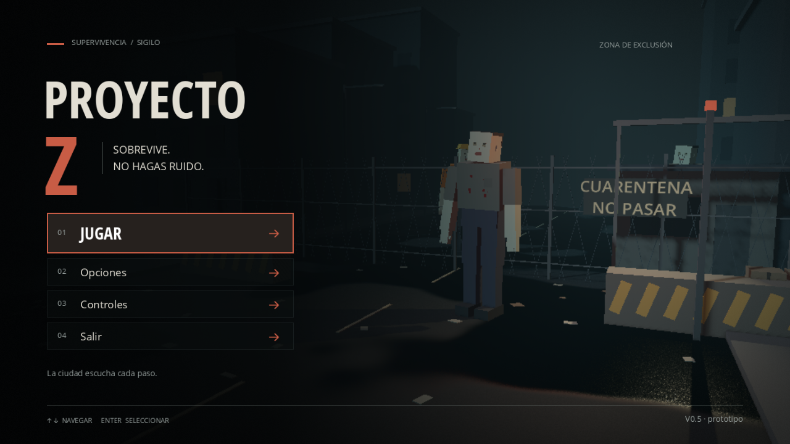

> Dirección vigente: [v7, bloques limpios sin repliegues](MODELOS_LIMPIOS_V7.md).

> Dirección vigente: [v6, todas las piezas cuadradas](CORRECCION_CUADRADA_V6.md).

> Revisión visual vigente: [v5](REVISION_VISUAL_V5.md). Conserva el estilo cuadrado de v4, contratos y flujo.

# Menú principal de cuarentena — 2026-11-16

Rediseño de la portada de Proyecto Z. La entrada sigue siendo `escenas/menu_principal.tscn`, que
usa `scripts/ui/menu_principal.gd`. No es necesario importar otra escena para ver el cambio al jugar.



[Opciones](capturas/menu-opciones.png) · [Controles](capturas/menu-controles.png) · [Ventana 4:3](capturas/menu-4-3.png)

## Presentación

- Escenario nocturno exclusivo: carretera, barreras, alambrada, cartel de cuarentena, niebla y luz roja.
- Tres rigs decorativos de los zombis existentes, con respiración y movimientos suaves. No ejecutan IA,
  física, navegación, ruido ni combate. No se carga el nivel de pruebas para decorar la portada.
- Título de dos líneas, acento rojo apagado, navegación numerada, foco visible y descripción por acción.
- Viñeta y grano sutil estático mediante `atmosfera_menu.gdshader`, sin imágenes ni servicios externos.
- Fuentes Open Sans incluidas con su licencia Apache 2.0 en `assets/fuentes/`.

## Funciones y controles

Se conservan Jugar, Opciones, Controles y Salir. Jugar utiliza `PantallaCarga` para entrar al nivel
existente. Salir usa un fundido antes de cerrar. Las acciones se desactivan durante la transición
para que pulsar Enter varias veces no duplique cargas.

Ratón o flechas para navegar; Enter para seleccionar. Esc cierra Opciones/Controles y devuelve el
foco a Jugar. Opciones reutiliza `PanelOpciones` y su guardado de preferencias. La lista de controles
incluye las acciones actuales de cuerpo a cuerpo. La pausa y el tema compartido de otros menús no
se rediseñaron: el tema nuevo se aplica localmente a la portada.

## Tamaños de ventana

La composición usa 1280×720 como referencia y se escala/centra dentro del viewport lógico de Godot.
Respeta el modo `canvas_items` ya configurado, que puede mantener un viewport lógico mayor que la
ventana física. Las pruebas convierten a píxeles de ventana con el transform final del viewport.
Los paneles están dentro de un contenedor con desplazamiento vertical para no perder sus botones.
No se modificaron `project.godot`, los controles del jugador ni la resolución del juego.

## Archivos que editar

- `scripts/ui/menu_principal.gd`: composición, botones, paneles, foco y transiciones.
- `scripts/ui/fondo_menu.gd`: geometría, actores, cámara y luces de la portada.
- `scripts/ui/atmosfera_menu.gdshader`: viñeta y grano.
- `assets/fuentes/`: fuentes originales y licencia; mantener sus avisos al distribuir.

## Pruebas y capturas

```bash
Godot_4.7.2 --headless --path . --fixed-fps 60 -s res://tests/menu_redisenado.gd
Godot_4.7.2 --headless --path . --max-fps 60 res://tests/escena_menu_test.tscn
tests/ejecutar_pruebas.sh /ruta/a/Godot_4.7.2
```

La prueba nueva recorre la UI mediante eventos reales de teclado, abre/cierra paneles, comprueba
cinco tamaños (640×360, 800×600, 1280×720, 1920×1080 y 2560×1080), activa Jugar y verifica que llegue
al nivel y que Enter repetido no duplique la carga. Preserva el archivo de preferencias original.
Al probar la carga asíncrona sin ventana, espera al hilo real para no terminar el proceso mientras
aún está leyendo la escena. El test antiguo recorre además pausa, opciones y regreso al menú.

Con renderizador activo, añadir `-- --capturas=/ruta` guarda principal, opciones, controles y 4:3.
En headless se omiten las capturas; ese modo verifica flujo/layout, no el aspecto visual.
Las capturas de esta entrega se obtienen de Godot con X11 y OpenGL Compatibility en llvmpipe (CPU),
no son un diseño externo ni un render de Blender. No prueban el rendimiento de una GPU del usuario.

Resultado del test nuevo: **52 comprobaciones correctas en headless**; **56 correctas con renderizado**
(las mismas 52 y cuatro capturas guardadas). El recorrido existente de menú → nivel → pausa/opciones
→ menú también terminó sin errores, sin pausa residual ni pantallas de carga pendientes.
Registros locales: `/workspace/setup-logs/menu-nuevo-test.log`, `menu-nuevo-render.log` y
`menu-nuevo-flujo.log`. Para las capturas en la nube se usó `--audio-driver Dummy`, ya que no hay
dispositivo de sonido; el aviso de VSync no disponible corresponde al display virtual de pruebas.

Batería general: **101/102 OK**. Único fallo: `moto_zombi`, ya documentado como intermitente; su
repetición aislada pasó. No se modificaron moto, zombis, combate ni las aserciones de esas pruebas.
Registros: `menu-nuevo-regresion.log` y `menu-nuevo-moto-repeticion.log` en `/workspace/setup-logs/`.
La carpeta `docs/capturas/` lleva `.gdignore` para que sus PNG no se importen como recursos del juego.
