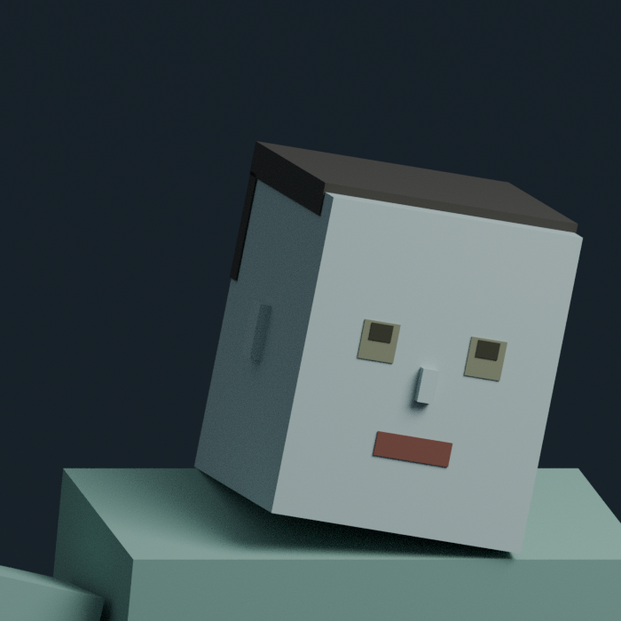
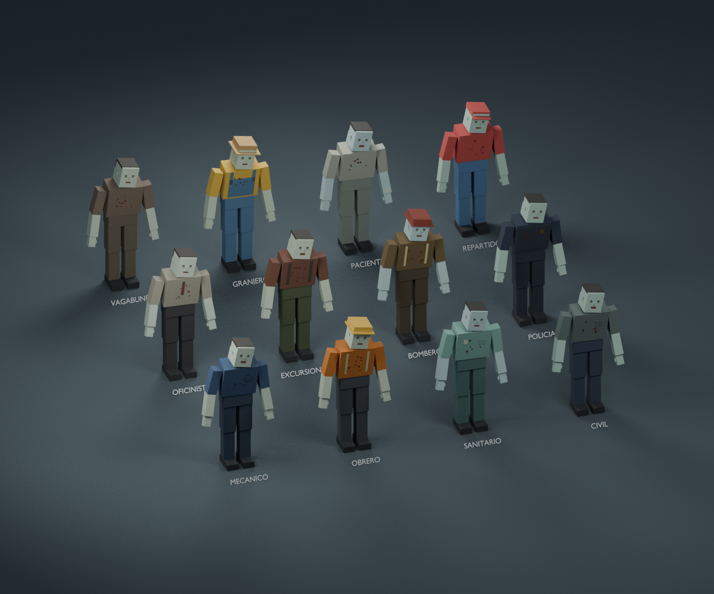
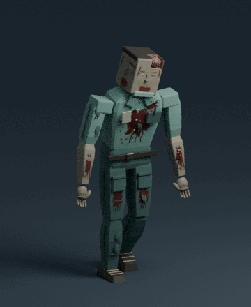
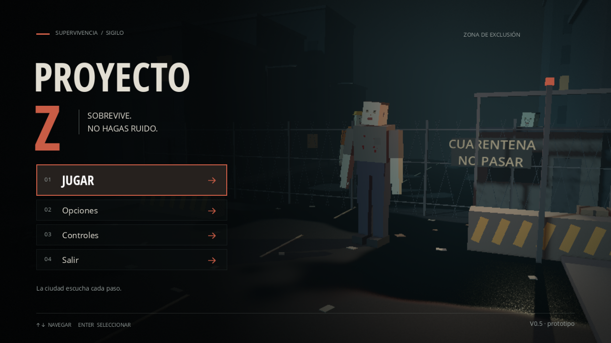

# Zombis de bloques limpios · v7

Se usan como referencia visual las tres imágenes aportadas por el usuario: granjero amarillo
con peto azul, repartidor con polo rojo y personaje de ropa marrón. No se incorporan las imágenes
ni sus marcas al juego. La petición es formas simples con ligeros detalles, todo cuadrado y
sin repliegues puestos encima.

## Resultado

- Un bloque rectangular limpio por segmento, palmas simples y pulgares pequeños.
- Ojos y boca mínimos, nariz discreta, sin capas de labios ni párpados superpuestos.
- Piel uniforme mate; sin mapas de poros ni tejido. Sangre plana de pocos píxeles cuadrados.
- Ropa diferenciada con colores y elementos mínimos de profesión. Granjero con sombrero y peto,
  repartidor rojo con gorra y pantalón azul; vagabundo de tonos marrones.
- Sin pliegues, tendones, coágulos, uñas independientes, remiendos ni masas cerebrales.
- Cráneo cerrado en todas las variantes, conforme a las referencias limpias. Sustituye la
  selección de tres cerebros de v4–v6; catálogo y pruebas verifican esta nueva expectativa.

Se conservan los quince segmentos y centros R15, escala en studs, cajas de impacto, seis clips,
IA y contrato de combate. Los objetos decorativos se fusionan dentro de esas quince piezas.

## Fuentes y validación

`refinado.py` ahora construye las variantes directamente, en vez de sumar capas sobre el diseño
anterior. `rostro.py` solo asigna piel plana y UV. `deterioro.py` genera una mancha RGBA por
píxeles. `superficie.py` se conserva como fuente histórica y no se invoca.

El generador comprueba caras planas, ausencia de biseles/subdivisión y de detalles prohibidos.
El validador comprueba dos PNG embebidos de 512×512, ausencia de normales de microrelieve,
cráneo cerrado, quince mallas, clips, hashes y normales planas. Godot comprueba daño, derribo y
muerte en cada variante. Las expectativas visuales se actualizan por el cambio solicitado.

Regeneración: `blender -b -t 4 -P animaciones/blender/zombis/generar.py` y
`python3 animaciones/blender/zombis/validar.py`. Motor disponible: Godot 4.6.3; falta comprobar
4.7.2 y medir una horda en GPU.

## Comprobaciones realizadas

Blender 4.3.2 y Godot 4.6.3. Doce GLB correctos, entre 398 y 458 triángulos por variante;
dos PNG embebidos y seis clips. Sin mapas normales ni materiales de cerebro.

- 624/624 comprobaciones de modelos: importación, clips, impacto, daño, derribo y muerte.
- 56/56 comprobaciones de menú con renderizado OpenGL Compatibility/llvmpipe.
- Batería general 101/102: único fallo `moto_zombi`, intermitencia documentada; repetición
  aislada OK con un atropello. No se modifican lógica ni aserciones del combate o moto.
- Catálogo de doce, primer plano y marcha revisados visualmente; capturas reales de menú.
- Un primer intento de menú agotó el tiempo bajo carga de render; repetición sin el render
  del catálogo pasó las 56 comprobaciones, sin ampliar el tiempo ni modificar aserciones.
