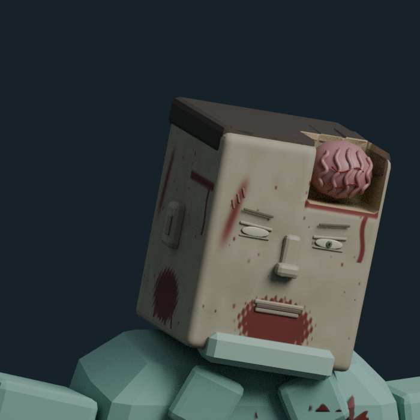
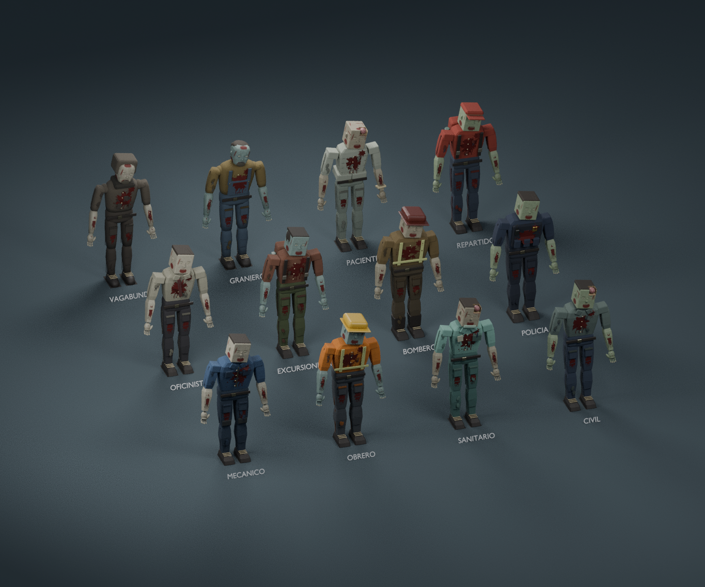
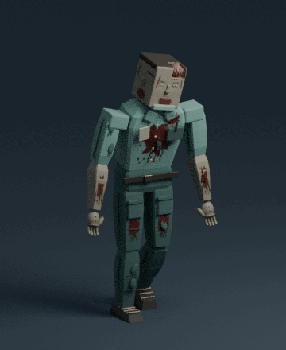
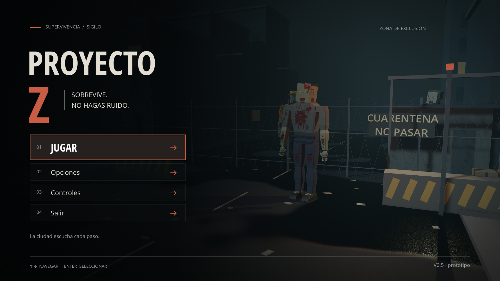

# Revisión visual v5 — zombis y puesto de cuarentena

## Dirección y alcance

Petición vigente: mantener el estilo cuadrado tomando al personaje principal como referencia,
y mejorar detalle y escenario del menú. Se conservan cabeza cuadrada, miembros de sección
cuadrada, proporciones, pivotes y cajas R15 del proyecto. Se descartó el ensayo redondeado
antes de entregar esta revisión.

- Cabeza cuadrada con ojos discretos y relieves bajos del diseño v4.
- Mapas de normales originales de poros y tejido en `superficie.py`, embebidos en GLB.
- Variación fina de piel; sangre y deterioro originales, cerebro visible solo en tres variantes.
- Retiradas astillas superpuestas del borde craneal: el Boolean aporta el borde óseo real.
- Calle del menú con fachadas, ventanas, aceras, garita, marquesina, suministros y restos.
- Iluminación fría exterior y foco cálido del control, sombras y asfalto húmedo procedural.

Se conservan nombres de variantes, 15 piezas, pivotes, dimensiones de impacto, seis clips, IA,
daño y ragdoll. El fondo del menú no añade cuerpos físicos ni navegación. Las superficies se
renderizan con materiales estándar exportables; el asfalto usa un shader espacial de Godot.

## Presupuestos y procedencia

Modelado y texturas originales generados localmente, sin proveedores, descargas de arte ni coste.
Blender 4.3.2. Cuatro PNG 512×512 embebidos por GLB: piel, sangre, normales de piel y normales de
tejido. Techo de 16.000 triángulos por variante, explícito en catálogo y validador. Se mantiene el presupuesto de geometría de v4. Las mallas conservan múltiples superficies:
15 objetos no significa 15 llamadas de dibujo. Rendimiento de hordas en GPU aún no medido.

## Regenerar y revisar

Desde la raíz del proyecto:

```sh
blender -b -t 4 -P animaciones/blender/zombis/generar.py
python3 animaciones/blender/zombis/validar.py
blender -b -t 4 -P animaciones/blender/zombis/render_catalogo.py
blender -b -t 4 -P animaciones/blender/zombis/render_animacion.py -- --detalle
godot --headless --path . --import
godot --headless --path . -s res://tests/modelos_zombis.gd
godot --headless --path . -s res://tests/menu_redisenado.gd
bash tests/ejecutar_pruebas.sh /ruta/a/godot
```

El catálogo, `.blend` y `.glb` se regeneran juntos; no editar solamente el binario. La galería
sigue siendo el lugar para revisar los seis clips. Para una comprobación final de dirección de
arte: ver cada profesión de cerca, caminar/perseguir, ataque y ragdoll; en menú probar Jugar,
Opciones y Controles a 16:9 y 4:3.

## Validación de esta entrega

Motor disponible: Godot 4.6.3; el proyecto
documenta 4.7.2. Las pruebas de esta entrega no equivalen a validación en 4.7.2. El addon Godot AI
rechaza activarse en 4.6.3; la importación avisa también de claves `runnable` ausentes en presets
preexistentes. No se modifica el plugin ni la configuración de exportación para silenciarlo.

## Vistas de revisión









Meshy: conexión comprobada, saldo consultado de 100 créditos. No se enviaron generaciones ni
se gastaron créditos: se priorizó conservar exactamente el lenguaje cuadrado y el rig existente.

## Resultados finales

- Validación de bytes: 12/12 GLB correctos, cuatro PNG embebidos, seis clips y hashes correctos.
- Godot: `MODELOS_ZOMBIS comprobaciones=624 fallos=0`.
- Menú con renderizado OpenGL Compatibility/llvmpipe: 56 comprobaciones, cero fallos.
- Batería general completa: 102/102, `TODO BIEN`; arranque de menú y nivel incluidos.
- Revisión visual: catálogo de doce variantes, primer plano, marcha y capturas reales del menú.
- Una ejecución anterior al ajuste final tuvo fallo en `suelo_pisoton --grupo --mira_abajo`;
  repetición aislada 5/5 y batería final completa en verde. No se cambiaron combate ni aserciones.

El resultado mantiene el estilo cuadrado. El detalle se mejora mediante materiales y relieve de
superficie; no pretende un acabado fotográfico. Falta medir hordas en GPU y comprobar en Godot
4.7.2. Las fuentes del protagonista y las tablas generadas del jugador no se modificaron.
